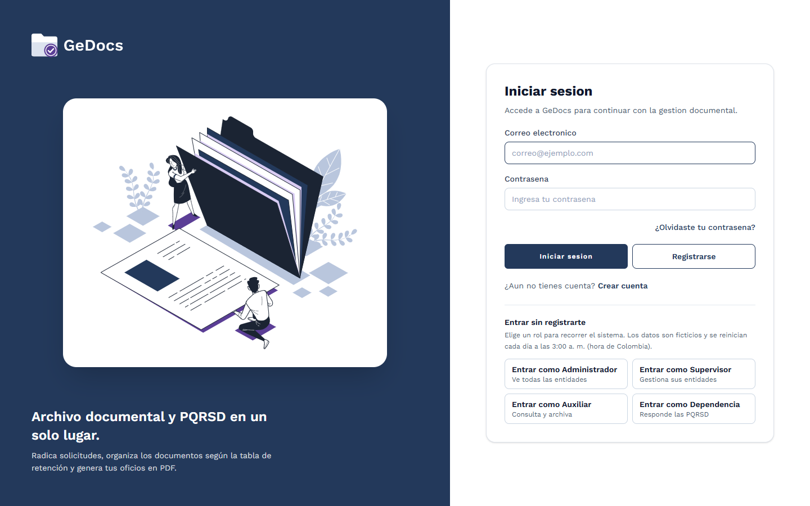
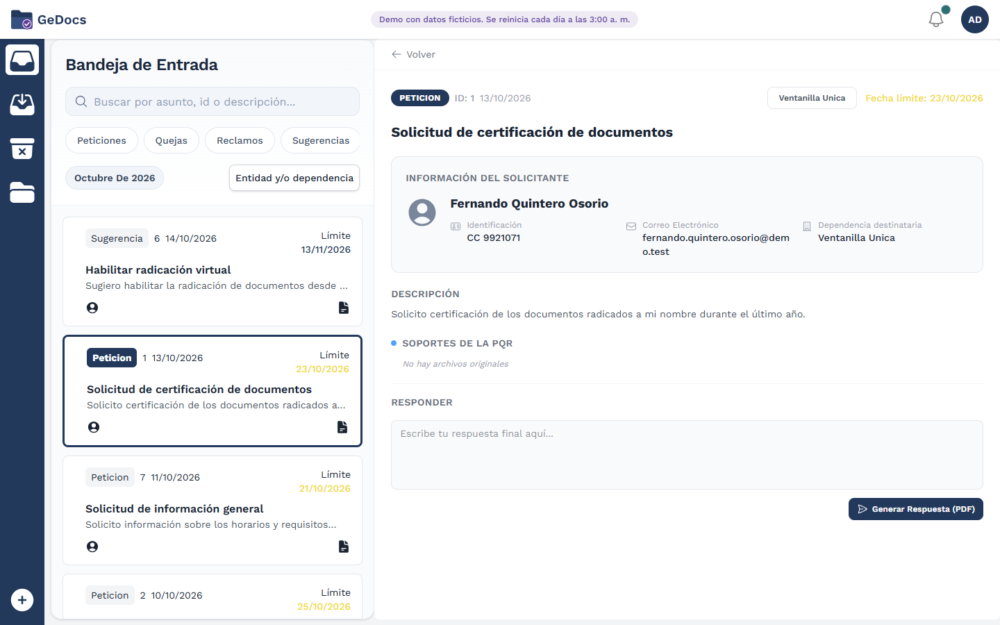
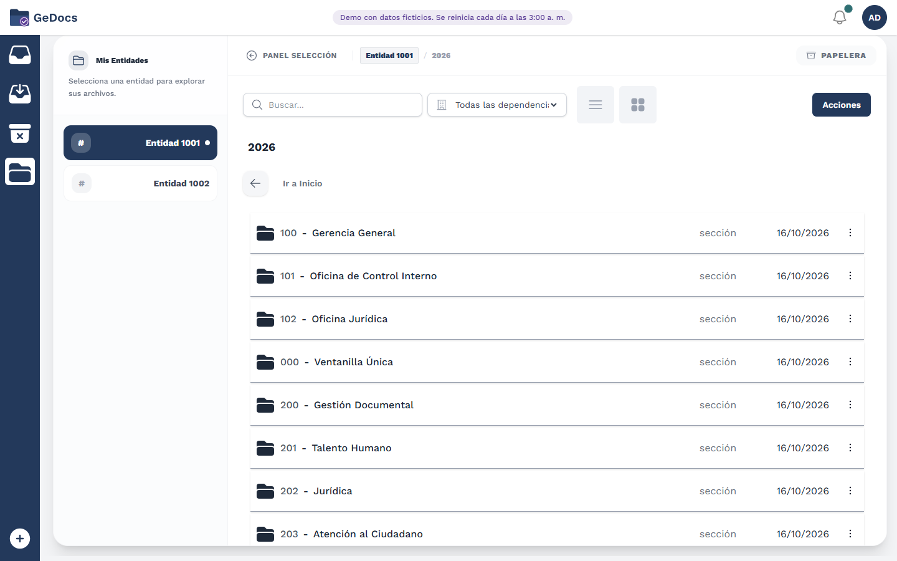
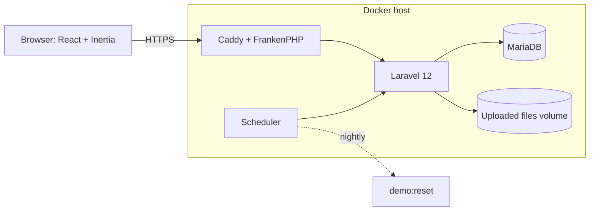

# Gedocs: document archive and PQRSD management (public demo)

A web application to keep an organization's documents organized by a records-retention schedule and to handle citizen requests (PQRSD: petitions, complaints, claims, suggestions) from filing to answer.

**Live demo:** coming soon (deployment in progress) · **Demo users:** `admin@demo.test` / `demo1234` (one-click buttons for every role on the login page)
All data is fictional and resets every night at 3:00 a.m. (Colombia). The interface is in Spanish because it follows Colombian records-management rules (Ley 594 de 2000).



## Context

Gedocs is a team project (9 people) built as the final project of a Software Analysis and Development technologist program. The original system runs in production for a public educational institution with about 60 users.

This repository is a **public demo** of that system. The institution's name, branding and data were removed with permission, all data is fictional, and the identity of the organization is now configurable (`config/institution.php`) instead of being written in the code.

## My role

I was not the author of the whole system; this is what I did:

- **Full-stack QA.** I led the testing strategy: Pest/PHPUnit for the backend business rules and Vitest with React Testing Library for the interface (see [Tests](#tests)).
- **UI/UX.** I designed the mockups of the main modules in Figma and the base design system.
- **Frontend.** I built the notifications hub and several other React screens, consuming the REST API.
- **Deployment.** I deployed the production system with Docker and Dokploy on DigitalOcean.
- **For this demo.** Configurable identity, neutral role names, fictional seed data and the nightly reset, a security review with the fixes and their tests, the Docker setup for Oracle Cloud's free tier, and CI that also scans for leaked institutional data.

## Features

- **Document archive.** Entities (organizations) with a yearly folder tree built from the retention schedule; upload, preview, rename, move, trash and restore; ZIP download; hierarchical classification codes and a SHA-256 hash per file.
- **PQRSD.** Public submission form with attachments, filing (radicado) numbers, due dates with automatic archiving of overdue requests, assignment to dependencies, replies with PDF letters, and an expiring one-time link so a citizen can answer without an account.
- **PDF generator.** Letters, circulars, minutes, reports and certificates with a per-user logo, signature and footer.
- **Reports.** Excel registers of received and sent communications.
- **Roles with data isolation.** Admin, Supervisor, Auxiliar and Dependencia; every user only sees the entities they belong to.
- **Notifications hub** and an **electronic index** of each file.
- **Demo mode.** One-click role access, a 3-step guided tour, protected demo accounts and a nightly reset.

| Inbox and a PQRSD | Archive explorer |
|---|---|
|  |  |

## Tech stack

| Layer | Technology |
|---|---|
| Backend | PHP 8.2+ (8.4 in Docker), Laravel 12, Sanctum, spatie/laravel-permission, dompdf, maatwebsite/excel |
| Frontend | React 18, Inertia.js 2, Vite 7, Tailwind CSS 4 + daisyUI 5 |
| Database | MariaDB 11.4 / MySQL (SQLite in memory for tests) |
| Tests | Pest 3, Vitest 4 + Testing Library |
| Delivery | Docker (FrankenPHP with Caddy and automatic HTTPS), GitHub Actions, Oracle Cloud Always Free |

## Architecture



Laravel serves the Inertia pages and a JSON API under `/api`; the browser talks to both with the same session cookie (Sanctum stateful mode). The identity of the organization (name, logo, PDF footer, filing number format) comes from `config/institution.php`. Authorization by entity is centralized in `App\Support\EntityAccess`. More detail in [docs/demo-decisions.md](docs/demo-decisions.md).

## Run locally

### With Docker

```bash
git clone https://github.com/<your-user>/gedocs-demo.git && cd gedocs-demo
cp .env.docker.example .env
docker compose build
docker compose run --rm --no-deps app php artisan key:generate --show   # paste the result as APP_KEY in .env
docker compose up -d                                                    # open http://localhost
```

### Without Docker (Linux, macOS or WSL)

Requires PHP 8.2+, Composer, Node 22 and MariaDB or MySQL.

```bash
composer install && npm ci
cp .env.example .env && php artisan key:generate     # set DB_* and APP_DEMO=true in .env
php artisan migrate:fresh --seed                      # loads the fictional data
npm run build && php artisan serve                    # or: composer dev
```

## Tests

```bash
php artisan test        # Pest: about 140 backend tests (SQLite in memory)
npm run test:unit       # Vitest: about 130 interface tests
```

The backend suite covers the business rules per role, the entity isolation, upload safety, demo mode and the seeded story. The frontend suite renders each screen per role with the API mocked. GitHub Actions runs both on every push, together with `composer audit`, `npm audit`, a scan for institutional traces and a secrets scan ([.github/workflows/ci.yml](.github/workflows/ci.yml)).

## Technical decisions

- **Identity as configuration, not find-and-replace.** Everything that names an organization lives in one config file and is injected into Blade, PDFs, Excel and the React app.
- **One place for authorization.** A bug review found that any signed-in user could read another entity's files by guessing IDs. [`EntityAccess`](app/Support/EntityAccess.php) now decides who can read or write what, and tests pin the behavior. See [docs/security-review.md](docs/security-review.md).
- **Safe public demo.** The reset command refuses to run unless `APP_DEMO=true`; the demo accounts are protected only in demo mode; seeding creates public-password accounts only in demo mode.
- **Role names in an enum**, mirrored in a JS constants file, instead of strings repeated across 60 places.
- **Deployable for free.** The image is built in CI for amd64 and arm64 and only pulled on the server, which keeps the 1 to 6 GB free VM comfortable ([docs/deploy-oracle.md](docs/deploy-oracle.md)).

## What I would improve

- Make filing numbers race-free with a database sequence; today two simultaneous requests can read the same maximum.
- Replace the static authorization service with Laravel policies and move the bigger controllers (`FolderController`, `PQRController`) into actions or services.
- Paginate the inbox and add end-to-end tests with Playwright on top of the unit and feature tests.
- Rename the `Sheet_number` model and table to match the interface term "entity".
- Fix accents in a few older interface strings.

## Credits

Built by the original team of 9 people. The retention-schedule structure and the PQRSD flow come from the original project.

| Name | Role in the original project | GitHub |
|---|---|---|
| Lydia Sierra | Scrum Master | [LydiaSierra](https://github.com/LydiaSierra) |
| Juan Manuel Velez | Backend | [Jumavxp](https://github.com/Jumavxp) |
| Luisa Coy | Backend | [luisajcoy](https://github.com/luisajcoy) |
| Juan Camilo Sanchez Fernandez | Frontend and backend | [Camilo5282](https://github.com/Camilo5282) |
| Sebastian Catellanos | Frontend | [Sebastian18131](https://github.com/Sebastian18131) |
| Juan Manuel Rios Ricaurte | Frontend | [JuanManuelRios327](https://github.com/JuanManuelRios327) |
| Julio Alexis Hoyos | Full stack | [Julioalexis434](https://github.com/Julioalexis434) |
| Genesis Elizabeth Navas Lara | Documentation | [GenesisNavas](https://github.com/GenesisNavas) |
| Johan Alexis Rendón Granada | Testing (QA), UI mockups, deployment | [joalregra](https://github.com/joalregra) |
